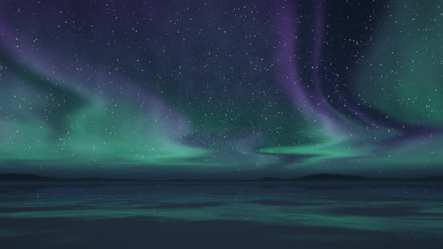
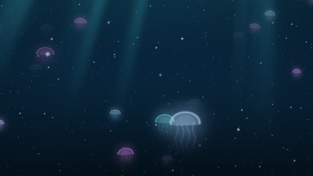
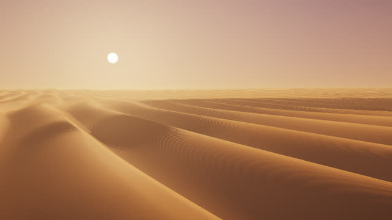
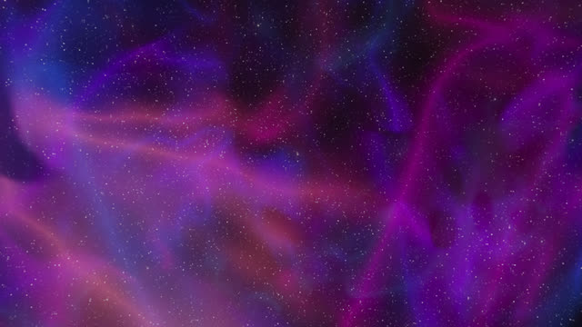

# Infinite Ambient

Endless scenes that you drift through, each with its own slow generative music that never plays the same way twice. The scenes run in a web browser with nothing to install. They are built to stay on all day as a live wallpaper.

Live gallery: <https://sulllll.github.io/infinite-ambient/>

## Scenes

| Scene | What you see | Music |
|---|---|---|
| <br>[Aurora Drift](https://sulllll.github.io/infinite-ambient/aurora/) | A slow glide over a frozen lake at night, under folding curtains of aurora. Snow drifts lie on the ice, far mountains stand on the horizon, and the ice mirrors the sky. | Glass bells, a felt piano and a wordless choir, mostly in E minor. Wind. |
| <br>[Abyss](https://sulllll.github.io/infinite-ambient/abyss/) | An endless drift through deep water. Faint shafts of light fall from far above, marine snow streams past, and soft glowing jellies pulse in the dark. | Deep drones, whale-like calls and sonar pings, mostly in A minor. Water. |
| <br>[Dune Sea](https://sulllll.github.io/infinite-ambient/dunes/) | A low flight over endless sand dunes at the golden hour. The sun rises a little and sinks again over about 32 minutes, so the light moves between gold and dusk. | Kalimba, warm pads and a felt piano, mostly in D. Desert wind. |
| <br>[Nebula Drift](https://sulllll.github.io/infinite-ambient/nebula/) | A slow flight through glowing clouds of gas between the stars. Near stars drift past, and far stars stay on the sky. | Slow pads, glass bells and two pianos, mostly in F Lydian. |

[Nightscape](https://github.com/sulllll/Nightscape) is the first scene of this kind: a flight above a sea of clouds at night, with a felt piano and a soft choir. It lives in its own repository, a fork of WeebLabs/Nightscape with added music. This repository holds only new code. It contains no code or assets from WeebLabs/Nightscape.

## Using a scene

Open the live gallery, or open `index.html` in a local copy. A local copy works straight from the disk, without a web server.

- Sound starts when you click or press a key. Browsers do not play sound before that.
- <kbd>G</kbd> opens the settings. <kbd>F</kbd> or a double-click toggles full screen. <kbd>S</kbd> turns the sound on and off. <kbd>Esc</kbd> closes the settings.
- The settings set the volume, the music level, the ambience level, the frame rate (15, 30 or 60 fps) and the resolution (automatic, or fixed between 40% and 100%). Each scene keeps its own settings in the browser.
- Each visit starts the music from a new random seed.

URL options:

| Option | Effect |
|---|---|
| `?fps=15` | Frame rate: 15, 30 or 60 fps. |
| `?scale=0.5` | A fixed resolution, from 0.2 to 1 of the window size. |
| `?t=600` | Start at this time, in seconds. |
| `?mute` | No sound. |
| `?nohint` | No hint about the sound and the keys. |
| `?shot` | Draw a few frames and stop, for screenshots. |

## As a wallpaper

- Windows: [Lively Wallpaper](https://github.com/rocksdanister/lively) (free) can show a web page as the desktop. Add a scene by its address.
- macOS: [Plash](https://github.com/sindresorhus/Plash) (free) can show a web page as the desktop.
- Any system: open a scene in its own full-screen browser window. The page tries to start the sound at once. Chrome allows that only when it starts with the autoplay switch:

```
chrome --autoplay-policy=no-user-gesture-required --kiosk https://sulllll.github.io/infinite-ambient/aurora/
```

Wallpaper apps differ in whether they let a page start sound without a click.

## Running for days

- The frame rate is capped at 30 fps by default. At 15 fps the graphics card does half the work.
- Drawing stops while the page is hidden, and the sound pauses.
- The automatic resolution keeps the graphics work near a fixed budget: 6 ms per frame, or 8 ms for Dune Sea. It reads the browser's GPU timer (`EXT_disjoint_timer_query_webgl2`). Without that timer, it lowers the resolution when frames come late and never raises it above the scene's default.
- Travel wraps at the scene's world period, and every slow motion is a closed loop. The numbers sent to the GPU stay small, so the picture never degrades.
- A lost graphics context is rebuilt. If the browser does not give it back within 15 seconds, the page reloads.
- Each music note frees its audio nodes when it ends, so nothing builds up over hours.
- The pages load nothing from the network.

Graphics work per frame, measured with the GPU timer on Intel Arc 140V integrated graphics (Chrome on Windows):

| Scene | One frame at 672 × 706 pixels | Default resolution |
|---|---|---|
| Abyss | 1.2 ms | 65% |
| Aurora Drift | 2.1 ms | 50% |
| Nebula Drift | 2.4 ms | 50% |
| Dune Sea | 7.8 ms | 55% |

672 × 706 pixels is about the pixel count of a 1920 × 1080 screen at 50% resolution. With the automatic resolution at 30 fps, the measured work stayed between 2.5 and 9 ms per frame in every scene.

## Music

Each scene has its own original generative score in the manner of tape-loop ambient music. Several loops each hold one soft note and repeat at their own length. No two lengths share a common beat, so the notes keep meeting in new combinations and the music never repeats exactly. Every eight to twelve minutes, all loops move together to a related set of notes. The Web Audio API synthesises every sound: bells, pianos, choir, pads, kalimba, drones and the ambience. There are no samples and no audio files.

The scores are original. They do not copy or quote any recording.

At the default settings, the music of every scene measures about −18.7 LUFS before the master volume (±1.5 dB between seeds). That is the level of the music in Nightscape, so the scenes sound equally loud.

## Tools

`tools/render-music.cjs` renders a scene's music offline, without a browser, so a change to the music can be checked without listening for hours. It reports invalid samples, the number of notes that sound each minute, the level and the loudness. It can also write a WAV file, normalised to a peak of −1 dBFS.

```
npm install node-web-audio-api
node tools/render-music.cjs aurora 900 48000 7 aurora.wav
```

The arguments are the scene, the length in seconds, the sample rate, the seed and the output file. Only the scene is required.

`tools/loudness.cjs` measures the integrated loudness of a 16-bit WAV file (ITU-R BS.1770, with gating):

```
node tools/loudness.cjs aurora.wav
```

## Layout

```
index.html           the gallery
shared/scene.js      the runtime: WebGL 2, frame rate, automatic resolution, settings panel, sound
shared/music.js      the generative music engine
shared/style.css     styles for the settings panel and the hint
<scene>/index.html   one page for each scene
<scene>/scene.js     the scene: its settings, its score and its fragment shader
thumbs/              pictures for the gallery
tools/               offline music render and loudness meter
```

## Adding a scene

Copy a scene folder and change its `scene.js`. A scene calls `InfiniteScene({ ... })` with these settings:

- `id`, `title`, `subtitle`: the names. `id` also keys the saved settings.
- `speed`: the travel in units per second. `period`: the world period, a size at which every noise scale in the scene repeats.
- `loops`: four loop lengths in seconds for the slow motions. The shader reads them as `uLoop`, each from 0 to 1.
- `scale`, `scaleMin`, `scaleMax`, `gpuBudget`: the default resolution, its limits and the budget in milliseconds per frame.
- `bed`: the ambience noise. `music`: the note sets, loops, hall, echo, tone and wow for `shared/music.js`. `musicGain`: the music level. Set it with `tools/render-music.cjs` so that the new scene matches the others in loudness.
- `frag`: the body of the GLSL fragment shader. The runtime adds helpers for noise, stars, the view ray and tone mapping.

The GLSL sits inside a JavaScript template literal, so it must not contain a backtick, not even in a comment.

## Licence

No licence has been chosen yet.

Made with WebGL 2 and the Web Audio API. No libraries, no network requests and no tracking.
